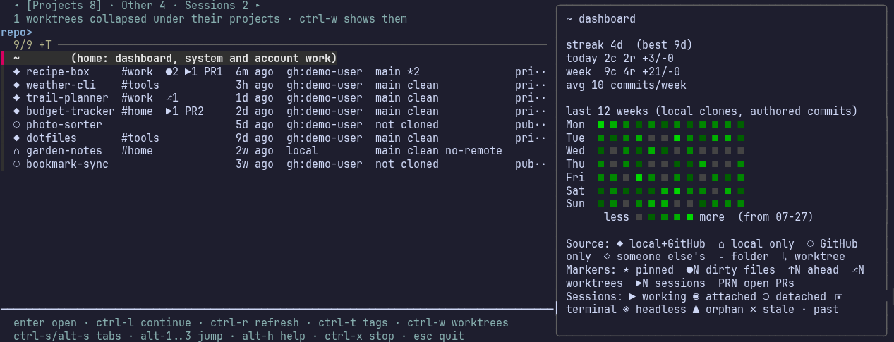
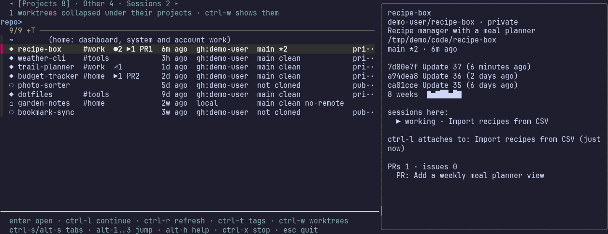
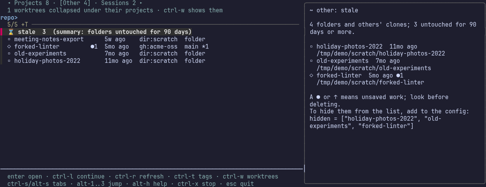
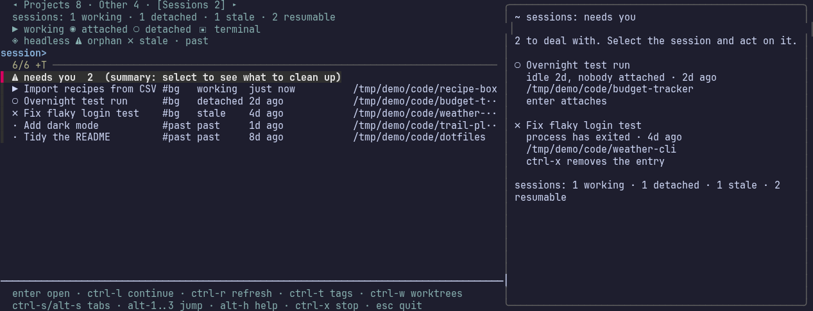

# claude-hub

A terminal launcher for Claude Code. It lists your projects (local clones and GitHub repos in one list, most recently used
first), previews their state, and starts `claude` in the one you pick. It also shows what needs cleaning up: stuck
sessions and folders you have stopped touching.

Command `claude-hub`, repo `jdk-official/claude-hub`. Runs in Ghostty (`ghostty -e claude-hub`) or any terminal.



*All screenshots use made-up demo data. Regenerate them with `python3 scripts/screenshots.py`.*

## Install

- Needs Python 3.11+, `fzf` (with `--listen`, `--footer` and `--track`; the picker says if yours is too old), `git` and
  `claude`. `gh` is optional but gives you GitHub-only repos and PR counts.
- `ln -s "$PWD/bin/claude-hub" ~/.local/bin/claude-hub`, then run `claude-hub`.
- Config lives in `~/.config/claude-hub/config` (TOML, optional). See [Config](#config).

## The three tabs

`ctrl-s` cycles Projects, Other and Sessions (`alt-s` goes back, `alt-1` to `alt-3` jump). Press Enter on a row to
open it. Each tab leads with a summary row whose preview is a dashboard; Enter on a summary row does nothing.

### Projects

Everything that is yours, whether it is cloned, on GitHub, or both, newest use first. "Use" is the latest of the last
commit, the last push and the last Claude session in that directory. Pinned repos come first.



Enter opens Claude there (a GitHub-only repo asks before cloning). `ctrl-l` continues the last session in the project.
Dirty files, unpushed commits and open PRs show as markers on the row and never change its position.

### Other

Plain folders and other people's clones. The first row, **stale**, previews every folder untouched for 90 days, marks any
with unsaved work, and prints a ready-to-paste `hidden = [...]` line for your config. claude-hub never deletes a folder.



### Sessions

Running and recent Claude sessions. The first row, **needs you**, lists the ones to deal with: orphaned sessions
(interactive, but the terminal is gone), stale registry entries, and detached sessions idle for a day or more. Aim for
zero. `ctrl-x` stops or removes one after asking; Enter attaches to a background session or resumes a past one.



`claude-hub sessions` prints the same list as plain text, handy over ssh.

## Reading a row

A leading glyph says where a project lives:

| Glyph | Meaning | Glyph | Meaning |
|---|---|---|---|
| `◆` | local and on GitHub | `◇` | someone else's clone |
| `⌂` | local only | `▫` | plain folder |
| `◌` | GitHub only (not cloned) | `↳` | worktree |

Markers after the name: `★` pinned, `●N` dirty files, `↑N` unpushed commits, `⎇N` worktrees, `▶N` live sessions,
`⚠N` orphaned sessions, `PRN` open pull requests. Session glyphs: `▶` working, `◉` attached, `○` detached, `▣` in a
terminal, `◈` headless, `⚠` orphaned, `✗` stale, `·` past. `alt-h` shows all of this in the picker.

## Keys

| Key | Does |
|---|---|
| Enter | open, attach or resume the selected row |
| `ctrl-l` | continue the last session in a project (by id) |
| `ctrl-s` / `alt-s`, `alt-1`..`alt-3` | next or previous tab, jump to a tab |
| `ctrl-w` | show or hide worktrees (collapsed under their project by default) |
| `ctrl-t` | cycle the tag filter |
| `ctrl-r` | refresh GitHub data and stats in the background |
| `ctrl-x` | stop or clean up a session (asks first) |
| `alt-h` | help and glyph key |
| Esc | quit |

Typing searches names and tags only, never the branch or age text.

## Config

`~/.config/claude-hub/config`, TOML. Top-level keys must come before the `[tags]` table.

```toml
owners = ["your-github-login"]          # whose GitHub repos to list
scan_roots = ["/home/you/code"]         # where local clones live
pinned = ["dotfiles"]                   # always first, in this order
hidden = ["old-experiments"]            # never listed (names or owner/name)
count = 10                              # rows for --list
start_tab = "projects"                  # or "other" / "sessions"; old "all", "local", "github" mean "projects"
show_worktrees = false                  # true lists worktrees by default

[tags]
recipe-box = ["work"]
```

## Auto-launch

A block in `~/.bashrc` starts claude-hub when a new Ghostty shell opens in your home directory.
`CLAUDE_HUB_AUTOSTART=always` shows it in every new Ghostty shell; `CLAUDE_HUB_AUTOSTART=0` turns it off.

## Development

- Script: `bin/claude-hub` (one Python file, standard library only).
- Tests: `python3 -m unittest discover -s tests`. Unit tests plus end-to-end tests that drive the real picker in tmux
  (they need `tmux` and `fzf`).
- Screenshots: `python3 scripts/screenshots.py` builds a throwaway sandbox under `/tmp/demo` (repos, GitHub listing,
  Claude sessions, all invented), drives the picker in tmux and renders each screen with headless Chromium. It needs
  `tmux`, `fzf`, `git`, `chromium` and ImageMagick.
- Project memory (handover, router, ADRs, tracking): [docs/INDEX.md](docs/INDEX.md). Requirements:
  [docs/requirements-brainstorm.md](docs/requirements-brainstorm.md).
